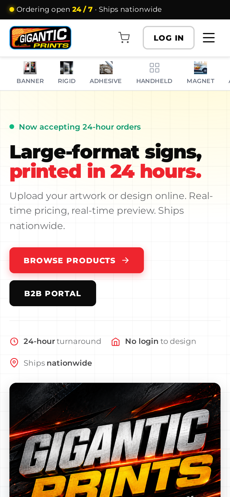
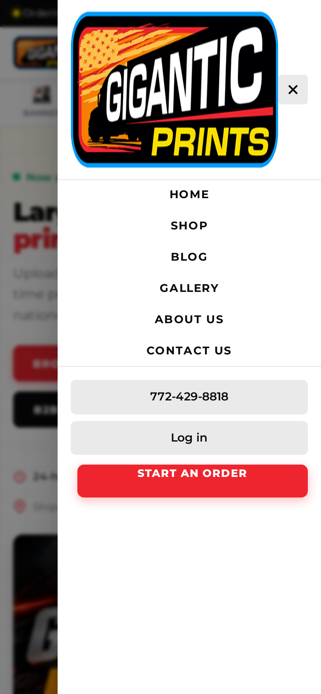
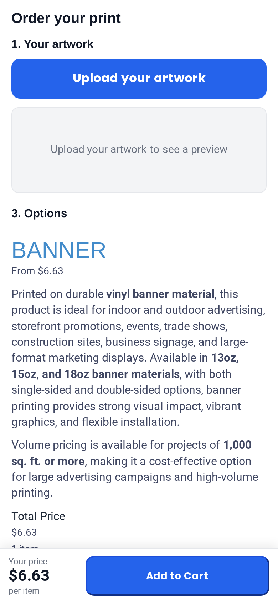
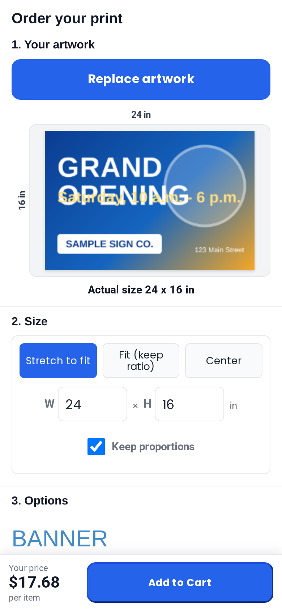

# Gigantic Prints online store - Handoff Guide

Prepared for **Hoyle Fabrio, SignEdge Graphics** by the **Printcart team**.
Store: giganticprints.com (staging address: giganticprints.printcart.com). Hosting is managed by Printcart.

<!-- DRAFT NOTES (never shown in the PDF; build_pdf.py strips HTML comments)
 B4-CHECK = wording or screenshot that must be confirmed after batch B4 is deployed (mobile, reorder, Image Zone, templates, private products, large-file preview).
 Screenshots: the capture list is docs/handoff/capture/shots.json (id = file name). batch "now" = captured; batch "b4" = captured in the final run.
-->

## How to read this guide

- **Part 1** tells you what was delivered and what comes next.
- **Part 2** is for your customers and your sales staff: what a shopper sees and does, step by step.
- **Part 3** is for you and your administrators: how to run the store behind the scenes.
- **Part 4** is the checklist for the day the store goes live on giganticprints.com.
- **Part 5** lists the questions we need you to answer.
- **Part 6** describes how support and care work after go-live.

Words in **bold** are the exact labels you will see on screen. Red outlines and numbers in the screenshots point at the thing to look at. Lines that start with **Check:** tell you what you should see if everything works.

---

## 1. Overview

### 1.1 What the store is

One store for everybody: visitors, retail customers (B2C) and business clients (B2B). It follows the ordering flow you described from Signs365:

**Product -> upload your art (or design online) -> instant preview at the real size -> options and live price -> cart -> checkout.**

Nobody needs an account to start designing. An account is needed when the order goes to the cart and checkout.

### 1.2 What was delivered, against your requirement list

| # | Your requirement | What you get |
|---|---|---|
| 1 | One site for visitors, B2C and B2B; Product > Upload/Design (no login) > Cart (login or create account) > Checkout | Delivered. Designing and uploading work without login. Registration is open on **My Account**; checkout asks guests to log in or register. |
| 2 | Price changes live with size and options; B2B sees the discounted price | Delivered. The price in the designer and on the product page follows size, material and options. Business clients see their own discounted price in the product page, designer and cart (the discount is applied once). |
| 3 | A separate account per company; repeat 5%, B2B 10%, reseller 20% | Delivered. Tiers **Returning customer (5%)**, **B2B (10%)**, **Reseller (20%)**; companies have their own portal and team. |
| 6, 17 | Customers mainly upload art; the designer is optional | Delivered. **Photos** tab in the designer, art is placed on the print area by itself. **Upload design** and **Custom design** buttons on the product page. |
| 17-18 | Preview of the art at the real size; size taken from the uploaded file; change size on the same screen; center or stretch | Delivered. The size is read from the file (pixels and DPI). **Stretch to fit**, **Fit (keep ratio)** and **Center**, width and height boxes, and the price updates at once. |
| 20 | Large files (20-200 MB and more), PDF, AI, PNG, JPG; resolution check | Delivered. Files up to **200 MB**; PNG, JPG, SVG, PDF, AI, EPS, TIFF. A **low resolution** warning appears when the art is below 100 dpi at the chosen size. The Add to Cart button is blocked while the print area is empty. |
| 7, 15 | Header and category bar in Signs365 order | Delivered. **Banner, Rigid, Adhesive, Handheld, Magnet, Apparel, Misc**. A category without products shows **Coming soon**. |
| 11-14, 26 | Products, options and prices from your price list (banner tiers, pole pocket, rope, acrylic minimum, magnets, apparel by linear inch, rush +100%) | Delivered and checked against your price list of 2026-06-18. Prices are shown in US format ($6.63) and catalog pages show **From $...**. |
| 16 | Combined products (one Magnet product, banner weights as options) | Delivered for Banner (13oz, 15oz, 18oz single and double sided) and Magnet. Other families keep the product structure you approved. |
| 22 | Register as B2C, ask for B2B, administrator approves, B2B profile | Delivered. **Apply for B2B** form, approval in the admin, company portal with team and invitations. |
| 23 | Private products per client; private template library; reorder in one click with the old art | Delivered in the last build, see sections 2.12-2.14 and 3.9-3.10. <!-- B4-CHECK --> |
| 24 | Image Zone | Delivered in the last build as the company's own image library, see 2.12. <!-- B4-CHECK --> |
| 29 | Phone and tablet | Phone ordering (390 px wide screens) delivered in the last build, see 2.15. Tablet follows the desktop layout. <!-- B4-CHECK --> |
| - | Security for accounts | Business invitations are tied to the invited e-mail; quote accept/decline needs a signed-in click; five failed logins lock the login name for 15 minutes; guest checkout is off; user names are not exposed. |

### 1.3 What is next

These items from your list are **not part of this release**. They are good candidates for the next phase:

- **Item list** on the left of the order screen (several items with their own art in one order, quantity per item, color matching and contour-cut buttons).
- **Grommet positions** all sides / top / bottom / left / right / custom (today: **No grommets**, **Grommets - 4 corners only**, **Grommets - Every 2 ft**), and the **Webbing mesh** option.
- **Super Admin Custom Order Form** for orders that come by phone or e-mail (planned as Phase 2). The quote module can be reused for it.
- **Chat widget, FAQs and how-to videos** in the header and footer.
- **QuickBooks export, Paymentech and Apple Pay** (outside the current scope; they can be planned separately).
- Fine tuning of text, images, About us, blog and gallery content with your material.

---

## 2. Shopper guide (what your customers see)

### 2.1 Browse and find a product

1. Open the home page. Under the header you see the category bar: **Banner, Rigid, Adhesive, Handheld, Magnet, Apparel, Misc**.
2. Click a category. Each product shows its starting price (**From $...**) and a **Start Design** button.

**Check:** prices are shown as $6.63 (dollar sign first, point for decimals). A category without products shows **Coming soon**.

### 2.2 Choose a product and a size

1. Open a product, for example **Banner**. The page shows photos, the description and the configuration panel with the **Total price**.
2. Material (13oz, 15oz, 18oz, single or double sided) is an option of the same product, not a separate product.
3. Press **Start Design**, or use **Upload design** / **Custom design** at the bottom of the product page.

The designer has four tabs on the left: **Photos** (upload), **Printing** (all options of the product), **Text** and **Layers**. The live price and the **Add to Cart** button are always on the right. <!-- B4-CHECK: the tab the designer opens on (Printing before B4, Photos after) must be confirmed in the final run -->

### 2.3 Upload your art and see the preview at once

1. In the designer open the **Photos** tab.
2. Drop your file on the box **Click or drop images here**, or click it and choose the file.
   Accepted file types and the size limit are written under the box: **png, jpg, svg, pdf, ai, eps, tiff** and **Max file size: 200 MB**.
3. A progress bar shows the upload. When it is done the art is placed on the print area automatically and the product takes the size of your file (for example a 3600 x 2400 pixel file at 150 dpi becomes 24 x 16 in).
4. The art bar above the print area shows **Actual size: 24 x 16 in**, and the rulers around the print area show inches.

**Check:** the preview shows the art on the print area with the rulers in inches, and the price on the right has changed to the price for that size. Large files take longer; the progress bar stays visible until the art appears.

### 2.4 Center, stretch or fit, and change the size

The art bar sits above the print area:

| Button | What it does |
|---|---|
| **Stretch to fit** | The art fills the whole print area exactly. If the proportions differ, the art is stretched. |
| **Fit (keep ratio)** | The whole art is visible inside the print area and keeps its proportions. |
| **Center** | The art keeps its real size and sits in the middle. |

To change the size, type a new number in **W** (width) or **H** (height). With **Keep proportions** ticked, the other number follows. Untick it to enter both. The unit is **in**. The price updates as soon as the size changes.

### 2.5 Resolution warning and empty print area

- If your file would print below 100 dpi at the chosen size you see: **Low resolution: about N dpi at W x H in. The print may look soft. Use a larger file or reduce the print size.** You can still continue; the warning disappears when the size is reduced or a larger file is used.
- If the print area is empty and you press **Add to Cart**, the store shows **Add your artwork first: upload a file or create a design, then press Add to Cart.** Nothing is added to the cart.

### 2.6 Options and live price

1. Stay on the **Printing** tab. Every option shows its label, the chosen value and the price effect (**Free** or an amount).
2. Banner options: **Grommets**, **Pole Pocket**, **Welding / Hemming**, **Rope Reinforcement**, **Wind Slits**, **Rush Production (24-hour turnaround)** and **Print-Sides** (the material: 13oz, 15oz, 18oz single or double sided).
3. Under the material choices the size field shows **Width** and **Height** with plus and minus buttons, in inches (banner: width 1 to 60 in, height 1 to 1200 in). When art is uploaded these boxes are filled from the file.
4. Pole pocket and rope are charged per linear foot of the size you chose; the price summary shows **Base price**, **Options**, **Quantity** and **Your price**.
5. When everything is right press **Add to Cart**.

**Check:** change the size or an option and watch **Your price** change before you press Add to Cart. Business clients see their discounted price here.

### 2.7 Design online (optional)

You do not have to upload anything. The tabs on the left (**Photos, Printing, Text, Layers**) let a customer add text, images and shapes, or edit the uploaded art. Designs can be saved to finish later (**My designs**).

### 2.8 Register and log in

1. Click **Log in** in the header (also available inside the designer).
2. On **My Account** use the login form, or the **Register** form to create an account with an e-mail address and a password.
3. A customer can design and upload without logging in; the store asks for login or registration when the order goes to checkout.

### 2.9 Cart and checkout

1. After **Add to Cart** the cart page shows each item with the thumbnail of the art, size, options and price.
2. Click **Proceed to Checkout**. A guest is asked to log in or register first.
3. Check the contact, shipping and billing details, choose the shipping option and the payment method, and press **Place Order**. (Shipping options and payment methods are switched on during go-live, see Part 4.)

### 2.10 My Account: orders, reorder, quotes

The **My Account** menu has **Dashboard, Overview, Orders, Downloads, Addresses, Account details, My designs**, **Log out** and **Apply for B2B**.

- **Orders**: all orders with their status. **Reorder** puts the same items, options and the original art into a new cart. <!-- B4-CHECK -->
- **My designs**: designs saved to finish later.
- **Request quote** and **My quotes**: ask for a price on a special job; when you receive a quote you can **Accept** or **Decline** it while you are signed in.

### 2.11 Ask to become a B2B client

1. Log in, open **My Account** and click **Apply for B2B**.
2. Fill in the form: **Company name**, **Business email**, **Contact name**, **Phone**, **Industry**, **Website**, expected monthly volume and a short description of the company.
3. Send it. The store tells you the application is under review.
4. The page also shows the three tiers (**Returning customer (5%)**, **B2B (10%)**, **Reseller (20%)**); your administrator assigns the tier after approval. When your application is approved you receive an e-mail. From your next login you land in the company portal, and the company discount (for example 10%) is applied automatically in the product page, designer and cart.

### 2.12 The company portal

After approval a B2B client works in the company portal (**B2B Portal** in the home page header, or the address /b2b-portal/). It has a left menu:

- **Overview**: your tier and discount, orders, total spent and savings.
- **Orders**: all orders of the company.
- **B2B Store**: the company profile.
- **Teams**: invite colleagues by e-mail. An invited person must register with that same e-mail address; they then share the company discount. The owner can see and remove members.
- **Image Zone**: the company's own library of artwork (logos, photos). Press **Upload** (PNG, JPG, TIF, PDF, AI or EPS, up to 100 MB per file); the files are private to your company. Each card has **Use in the designer** and a delete button. Company members also see the Image Zone in the **Photos** tab of the designer and can place an image with one click. <!-- B4-CHECK -->
- **Templates**: the company's private template library. In the designer, a **Templates** bar offers **Save as company template** (you type a name) and a list **Load template...** (templates are kept per product; loading one replaces the art on the canvas after you confirm). The **Templates** page of the portal lists what your company saved. Other companies and the public never see them, and the public templates can be hidden for your company. <!-- B4-CHECK -->
- **Request quote / My quotes** and **My Account** (Dashboard, Orders, My Profile).

### 2.13 Private products

Products that Printcart assigns to your company in the admin appear in the shop and in search only when a member of your company is logged in. For everybody else they do not exist (the product address shows a "page not found"). <!-- B4-CHECK -->

### 2.14 Prices for B2B clients

1. Log in with a company account and open the designer, product page or cart.
2. The price shown is already reduced by the company tier (for example 10% for B2B, 20% for Reseller). It is reduced once, never twice.

**Check:** the same 24 x 16 in banner costs less for a company than for a retail customer, and the cart shows the same amount as the designer.

### 2.15 Ordering from a phone

On a phone (about 390 px wide) the store has no sideways scrolling and the designer is replaced by a phone order flow: upload, preview, size, options and a sticky **Add to Cart** button. <!-- B4-CHECK -->

---

## 3. Administrator guide (how to run the store)

### 3.1 Sign in and find your way

1. Open **giganticprints.com/wp-admin** and sign in with your administrator account.
2. The menu on the left is the whole store:
   - **Products** and **WooCommerce** (orders, customers, coupons, settings),
   - **PC Designer** (the designer, **Printing Options** with sizes, options and prices),
   - **B2B & B2C** (companies, tiers, quotes),
   - **Pages**, **Posts**, **Media**, **Appearance** (menus), **Users**, **Settings**.

### 3.2 Products and combined products

A **combined product** is one product that contains its variants as options: for example **Banner** holds 13oz, 15oz and 18oz, single and double sided, and all sizes. The customer picks them on one screen.

**See and edit products**

1. Open **Products > All Products**.
2. Click a product name to edit it: title, description, product image and gallery, **Product categories**.
3. In the box **PCD options** the tab **Printing Option** holds the checkbox **Enable Printing option** and the link **Edit option**, which opens the option set of this product (see 3.3). The tab **Setting PCDesigner** holds **Enable Design**, **Enable Upload Design** and **Enable Upload Without Design**.
4. Click **Update** to save.

> The **Price** column in the products list can show "From $0.00". The real prices come from the option set (3.3) and are shown correctly in the shop.

**Add a new product**

1. **Products > Add new product**. Give it a title, description, image, and tick its category.
2. Open **PC Designer > Printing Options > Add new**, type a title, choose **Apply for: Products** and select the new product on the right, then build the fields (3.3) and press **Publish**.
3. In the product, enable the printing option and the design settings you need, and **Publish**.

### 3.3 Option sets and the price table

**PC Designer > Printing Options** lists one option set per product (or per category). Click a title, or **Edit**, to open **Edit Options**. Do not delete an option set that is in use.

The page has:

- **Publish** box on the right (priority, **Update** button) and **Apply for** (the product or the categories the set belongs to).
- **Printing fields**: the building blocks (for example **Size**, **Custom dimension**, **DPI**, **Rounded corners**).
- **Printing options**: the list of fields the customer sees, in order: for Banner **Grommets**, **Pole Pocket**, **Welding / Hemming**, **Rope Reinforcement**, **Wind Slits**, **Rush Production**, **Print-Sides** and one size field per material (**13oz Single-Sided**, **15oz Single-Sided**, **18oz Single-Sided**, **18oz Double-Sided**). Click the arrow at the right of a field to open it.

### 3.4 How to change a price

**A price per area (the price table of a size field)**

Banner, vinyl and similar products are priced by area. The price table lives in the size field of the option set.

1. **PC Designer > Printing Options**, open the set of the product (for Banner: **13oz Vinyl Banner (Single-Sided)**).
2. In **Printing options** find the size field of the material, for example **13oz Single-Sided**, and click the small arrow at the right of its row to open it.
3. Open its tab **Online design**. You see:
   - **Dimension range** (Min, Max, Step and Default value of **Width** and **Height**, in inches),
   - **Enable measure price base on design area**: **Yes**,
   - **Price base on design area**: the price table with the columns **Measurement Range (From / To)** and **Price per Unit ($/in2)**.
4. Change the **Price per Unit** of the row you want, or change the **From** / **To** of the ranges. **Add Rule** adds a row; to remove rows tick them and press **Delete Selected**.
5. Press **Update** (top right of the page).

**Units: the table works in square inches.**

- **Price per Unit** is the price for **one square inch**: price per square foot divided by 144. Example: $6.63 per sq ft is 6.63 / 144 = 0.046042 per sq in.
- **From** and **To** are areas in square inches: square feet x 144. Example: 1000 sq ft = 144000 sq in, so the first range ends at 143999 and the next one starts at 144000.
- The last range has an empty **To** (it applies to everything above its start).

**Check after every change:** open the product in the shop, set a size that falls in the changed range and compare the price on screen with your price list (for example 24 x 16 in = 2.667 sq ft x your price per sq ft). Test the smallest range, the largest range and one size on each side of a range boundary.

**An add-on (for example Pole Pocket, Rope Reinforcement, Wind Slits)**

1. Open the option set, click the add-on field (for example **Pole Pocket ($1.00 per linear ft + $10 setup)**).
2. Each choice (for example **No pole pocket**, **Top only**, **Bottom only**, **Top & Bottom**) has its own price line; change the amount or the label and press **Update**.
3. Pole pocket and rope are special: they are priced per linear foot of the chosen size (pole pocket: width x number of sides, plus a setup fee; rope: perimeter). Their rates are kept in the store's code, not in the price line of the choice. **To change the rate or the setup fee of the pole pocket or the rope, ask the Printcart team** (it is a small change; we will make it editable on request, see Part 5).
4. Rush production is an option that doubles the price of the item including its options.

> The price you type in a field is in your shop currency (US dollars). Labels in brackets, such as "($1.00 per linear ft + $10 setup)", are text for the customer: if you change a rate, change the label too.

**Quantity breaks**: the top of **Printing options** has **Quantity** with a **Quantity breaks** table (minimum quantity and discount per item). Leave it unless you want volume prices on a product.

### 3.5 Tier discounts

**B2B & B2C > Pricing Rules**, section **Tier Discount Ladder**:

| Tier | Discount | Meaning |
|---|---|---|
| **B2C - Retail price** | 0% | Everybody else |
| **Returning customer (5%)** | 5% | Customers who have ordered before (automatic after repeat orders) <!-- B4-CHECK --> |
| **B2B (10%)** | 10% | Approved business clients |
| **Reseller (20%)** | 20% | Resellers |

To change a discount press **Edit** on the tier row. The dialog **Edit pricing rule** opens: change **Discount** (a percentage, shown as "% off") and, if needed, **Rule name** or **Status**, then press **Save rule**. Leave **Tier key** as it is. The **Payment terms** field is a note for you; it does not change how checkout works. Older tiers that are not used are marked **Inactive**. Discounts apply to future carts and orders only; past orders do not change.

Below the ladder you find **Quantity-Based Discounts** (extra discount for larger quantities; empty now) and **Special & Promo Rules**.

### 3.6 B2B settings and approving a B2B request

**B2B & B2C > Settings**, tab **B2B Settings**:

- **Allow self-registration** (shows **Apply for B2B** on the account page),
- **Auto-approve applications** (leave off to approve each request yourself),
- **Default tier on approval** (the tier a newly approved company gets).

**Approve a request**

1. When a customer applies, the **B2B & B2C** menu shows a red number. Open **B2B & B2C > B2B Stores**, tab **Pending applications**.
2. Click the company to see its details: company name, contact, tax id, address.
3. Click **Approve B2B Application**, add an optional note and confirm. The company gets the tier, the applicant gets an e-mail and sees the company portal at the next login.
4. To decline click **Reject Application**.

### 3.7 Company management and private products

1. **B2B & B2C > B2B Stores**, click a company. The detail page shows the owner, members, tier and orders.
2. **Edit** changes the company name, address or tier. A company can be suspended: its members then lose the company prices.
3. **Invite store** (button at the top of the list) invites a company by e-mail; invitations are bound to that e-mail address and appear in **B2B & B2C > Invitations**.
4. **Private products**: in the company detail page the box **Private products** lists all products with a search field. Tick the products that only this company may see and buy and press **Save private products**. A product assigned to one or more companies is hidden from everyone else (shop, search, direct address, sitemap). Under the list, **Hide public templates for this company** removes the public template gallery from this company's designer. <!-- B4-CHECK -->
5. **Customers** lists every customer with tier, orders and spend; **Customers > a name** lets you change a customer's tier by hand.

### 3.8 Orders and the print-ready files

1. **WooCommerce > Orders** lists all orders. Click an order number to open it.
2. Each order line shows the options and a design block with the download links: **Download designs: PDF / PNG / SVG / JPG** and **Download upload files** (the customer's original files, at full size).
3. Download the files, print, then set the order status (**Processing**, **Completed**, ...). The customer receives the matching e-mail.

**Check:** the downloaded PDF has the size of the order (for example 24 x 16 in) and contains the art as uploaded. File types offered for download can be limited in **PC Designer > Settings** (**Design file type download**).

### 3.9 Quotes

1. **B2B & B2C > Custom Quotes** lists the requests from customers; the menu shows a red number for new ones.
2. Open a request, review products and notes, edit the prices, **Save** and **Send to Customer**.
3. The customer receives an e-mail and can **Accept** or **Decline** while signed in. Accepting converts the quote into an order.

### 3.10 Menus and categories

- **Category bar** (Banner ... Misc): **Products > Categories**. The bar shows the top-level categories in the order set there (drag to reorder), with the category image as the icon. An empty category shows **Coming soon** until it gets a product.
- **Top menu** (Home, Shop, Blog, Gallery, About us, Contact us): **Appearance > Menus**.

### 3.11 Pages, blog and gallery

- **Pages > All Pages**: About us, Contact, Gallery, legal pages. Click a page to edit it; **Update** publishes.
- **Posts > All Posts**: blog articles. **Add Post** writes a new one; set **Categories** and a featured image.
- **Gallery Items**: items of the Gallery page.
- Photos: **Media > Library**.

### 3.12 Users

**Users > All Users** lists all accounts. **Add User** creates an account; pick the role (**Administrator** for full access, **Shop manager** for orders and products only, **Customer** for shoppers). Each administrator should have a personal account and a strong password.

### 3.13 E-mail notifications

- **Order e-mails** (new order, processing, completed, ...): **WooCommerce > Settings > Emails**. Click **Manage** next to an e-mail to change its subject, heading and recipients. The e-mails that go to the shop (**New order**, **Cancelled order**, **Failed order**) are currently addressed to a Printcart address: replace it with yours before go-live.
- **Sender address and mail service**: **WP Mail SMTP**. The from address should be an address on your own domain.
- **Design notifications** (a customer saved a design, designs approved): **PC Designer > Settings > General**, section **Notifications**; **Recipients** lists who receives them.
- **B2B e-mails** (application received, approved, rejected, invitation, quote) are sent automatically by the store.

### 3.14 Payment settings

**WooCommerce > Settings > Payments** lists the payment providers: **Accept payments with Woo**, **Take offline payments**, **PayPal** and **More payment options**. At the moment no payment method is switched on, so no customer can pay yet; this is finished in Part 4.

1. Click **Complete setup** next to **PayPal** (or **Manage** next to the provider you choose) and follow the steps: connect your own account.
2. Use the **live** account of your own company only when you go live; until then keep the provider in test mode.
3. After saving, open the cart and checkout once to see that the payment method is offered.

### 3.15 Settings you may need

- **PC Designer > Settings > Upload design**: allowed file types and limits. Leave them as delivered unless Printcart advises a change.
- **Settings > General**: site title, administration e-mail.
- **Settings > Reading**: **Search engine visibility** (see Part 4).
- **Users > Profile**: your own password.
- **UpdraftPlus**: backups.

---

## 4. Go-live checklist

Printcart does the technical steps marked **(Printcart)**; you do the steps marked **(you)**.

| # | Step | Who | Done |
|---|---|---|---|
| 1 | **Domain:** Printcart sends you the DNS records for giganticprints.com; you (or your DNS provider) change them. Keep your Google mail (MX) records exactly as they are. The store switches to the new address and the secure padlock (HTTPS) is checked. | you + Printcart | [ ] |
| 2 | **Search engines:** in **Settings > Reading** untick **Discourage search engines from indexing this site** and press **Save Changes**. Until then the store is hidden from Google on purpose. | Printcart / you | [ ] |
| 3 | **Passwords:** the administrator password that was sent to you by e-mail during the project must be changed. **Users > Profile > Set New Password**. Create a personal administrator account for each person and remove accounts you do not recognise. | you | [ ] |
| 4 | **Payment:** in **WooCommerce > Settings > Payments** connect your own payment account (for example **PayPal > Complete setup**), switch test mode off, and check that checkout offers the payment method. Today no payment method is switched on. | you | [ ] |
| 5 | **Sender e-mail:** set the from address in **WP Mail SMTP** and **WooCommerce > Settings > Emails**, and the **Recipients** for design notifications in **PC Designer > Settings**, to addresses on your domain, and replace the recipient of **New order**, **Cancelled order** and **Failed order** in **WooCommerce > Settings > Emails** (today a Printcart address). Send a test e-mail. | you + Printcart | [ ] |
| 6 | **Legal pages:** publish **Terms and Conditions**, **Privacy Policy** and **Refund policy** and make the footer links point to them. | you + Printcart | [ ] |
| 7 | **Shipping and tax:** in **WooCommerce > Settings > Shipping** add the shipping zones and rates you want (today checkout shows "No shipping options are available for this address" for a US address) and check **Tax**. | you + Printcart | [ ] |
| 8 | **Test order:** place one real order with a small print file; check the order e-mails, the download links in the order, and the confirmation page. Then cancel or refund it. | you + Printcart | [ ] |
| 9 | **Remove test data:** test accounts, the sample company, sample quotes and invitations and test orders are removed. | Printcart | [ ] |
| 10 | **Public pages:** unpublish pages that are not part of your store (sample and placeholder pages). | Printcart | [ ] |
| 11 | **Updates and backup:** all software updates installed, a fresh backup taken and a restore test noted. | Printcart | [ ] |
| 12 | **After go-live:** check the first real orders the same day and tell us about anything unexpected. | you | [ ] |

Where to untick the search engine box (step 2):

---

## 5. Questions for you

Please answer these so we can finish the details.

1. **Wind slits:** is the price **$0.50 per square foot** of the banner, or a **flat** amount per banner? Today the option charges a flat amount.
2. **Pole pocket setup fee:** is the **$10 setup** charged **per item**, or **once per order line** (one size on the order, whatever the quantity)? Today it is charged per item.
3. **Grommets:** which positions do you want (all sides, top, bottom, left, right, custom) and should **Yes** be the default? Today the choices are **No grommets**, **4 corners only** and **Every 2 ft**, default **No grommets**.
4. **Webbing mesh:** should it be an option? Please send the specification and the price.
5. **Returning customer 5%:** after how many orders (or what spend) should a customer move to this tier? Today it follows the second paid order.
6. **Resellers (20%):** how do you recognise a reseller: do you approve them yourself in **B2B Stores**?
7. **Handheld and Misc:** which products belong in these two categories? Until they have products they show **Coming soon**.
8. **Payment:** which payment provider do you want to use at go-live, and who creates the account?
9. **Mail:** which address should orders, quotes and design notifications go to, and which address should customers see as the sender?
10. **Legal text:** do you have Terms, Privacy and Refund texts, or should we prepare a draft for you to review?
11. **Item list:** how important is the item list (several items with different art in one order)? It is the next big feature on your list.
12. **Administrators:** who needs an administrator login and who only needs to process orders (Shop manager)?

---

## 6. Support and care

After go-live the store is hosted and looked after by **Printcart**.

**What care covers**

- Hosting of the store and its secure connection (HTTPS), managed by Printcart.
- Regular backups and the ability to restore them.
- Software updates and security fixes for the store, the designer and its extensions, tested before they go live.
- Monitoring that the store is reachable and that ordering works.
- Help with questions about using this guide, the admin screens and the designer.
- Small corrections to what was delivered (for example wording, a price table row, a menu item) when they are reported together.

**What is quoted separately**

- New features and larger changes (for example the item list, new product families, integrations such as accounting export or additional payment methods).
- Content work (writing pages and articles, photography).

**How to ask for help**

- Write to the Printcart support address you were given, with a short description, the page address, and a screenshot if possible. For an order, add the order number.
- Reports about orders that cannot be placed are looked at first.
- For any change to prices or products you can make yourself, use Part 3. If you are unsure, ask us before you change anything on the live store.

*Printcart team*
